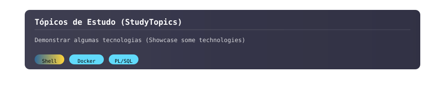

<p align="center">
  
</p>

<!--

-->

---

# **`Fatec Ourinhos`**

>[!IMPORTANT]
> O foco deste repositório é reunir scripts avulsos de tópicos de estudo que desenvolvi enquanto estudava na Fatec Ourinhos. Inclui, por exemplo, materiais relacionados a Docker, iptables, PL/SQL, scripts de configuração, auditoria e monitoramento de servidores, entre outros assuntos que serão abordados e ampliados gradualmente.

---

>[!IMPORTANT]
> The focus of this repository is to collect standalone scripts on various study topics that I developed while studying at Fatec Ourinhos. It includes, for example, materials related to Docker, iptables, PL/SQL, configuration scripts, server auditing and monitoring, among other subjects that will be gradually expanded over time.


---

## 📂 Estrutura do Repositório (Repository Structure)

<details>
  <summary><b>Abrir para visualizar (Open to view)</b></summary>

```text
├── DataBaseExercices
│   ├── 01_Criacao_Tabelas
│   │   ├── ex1.sql
│   │   └── README.md
│   ├── 02_Chaves
│   │   ├── ex2.sql
│   │   └── README.md
│   ├── 03_Usuarios
│   │   ├── ex3.sql
│   │   └── README.md
│   ├── 04_Privilegios
│   │   ├── ex4.sql
│   │   └── README.md
│   ├── 05_Perfis
│   │   ├── ex5.sql
│   │   └── README.md
│   ├── 06_Introducao_Procedimentos
│   │   ├── ex1.sql
│   │   ├── ex2.sql
│   │   ├── ex3.sql
│   │   ├── ex4.sql
│   │   ├── ex5.sql
│   │   └── README.md
│   └── 07_Funcoes_Matematicas
│       ├── ex1.sql
│       ├── ex2.sql
│       ├── ex3.sql
│       ├── ex4.sql
│       ├── ex5.sql
│       └── README.md
├── Docker
│   └── apache-hardening
│       ├── Dockerfile
│       └── hardening-apache.sh
├── Iptables
│   ├── Lista1
│   │   ├── Exercicios de Firewall Iptables-v2.png
│   │   ├── lista1.sh
│   │   └── README.md
│   └── Lista2
│       ├── lista2.sh
│       ├── README.md
│       └── Untitled.png
├── README.md
└── Scripts
    ├── contDir.sh
    ├── contPack.sh
    ├── gerenciaVolume.sh
    ├── limitLatencia.sh
    ├── README.md
    ├── verLogin.sh
    └── verService.sh
```

 </details>


---


<details>
<summary><b><code>Tópicos de Estudo</code></b></summary>

<details>
<summary><b>Sobre Contêiners, Docker e AWS</b></summary>

Contêineres e Docker foram tecnologias introduzidas em minha trajetória de estudos por meio da disciplina *Estudos Avançados de Segurança da Informação*, lecionada pelo professor José Santiago Moreira de Mello.

Nessa disciplina, aprendemos a criar instâncias virtuais na AWS por meio do EC2 e, a partir disso, utilizamos Docker tanto no **Linux** quanto no **Windows**. Além disso, o professor nos concedeu a oportunidade de estudar certificações **AWS**, que podem ser vistas no repositório do meu perfil. 

Sobre Docker em si, aprendemos tópicos como: manipulação de imagens, serviços, Dockerfile, volumes (armazenamento e persistência) e Infrastructure as Code (IaC) com Docker Compose. 

Para representar uma parcela do que vimos, escolhi colocar no repositório um simples projeto: a primeira parte consiste em um **Hardening de Apache** e a segunda parte em um **Dockerfile** para o Hardening do Apache.

```
#Dockerfile-Hardening-Apache
#---------------------------#
#Criar um diretório para o projeto
mkdir apache-hardening
cd apache-hardening

# Conteúdo do Dockerfile
vim Dockerfile

FROM httpd
RUN sed -i 's/Options Indexes FollowSymLinks/Options FollowSymLinks/' /usr/local/apache2/conf/httpd.conf
RUN rm /usr/local/apache2/htdocs/index.html
CMD ["httpd-foreground"]

# Criar a imagem Docker
docker build -t apache-hardening .

# Executar um contêiner com a imagem personalizada
docker run -d -p 80:80 --name meu-apache-container apache-hardening
```


</details>

<details>
<summary><b>Sobre Iptables e Desenvolvimento de Sistemas</b></summary>

O assunto de **iptables** é abordado desde o terceiro semestre, mas é aprofundado principalmente no quinto e sexto semestres, sendo que no sexto semestre há a adição do **pfSense**. Para representar isso, incluímos alguns exercícios e scripts que envolvem iptables, juntamente com seus respectivos mapas de rede. Essas disciplinas foram lecionadas pelos professores, de forma geral: Paulo Roberto Galego, Thiago José Lucas e Eduardo Alves Moraes.


</details>

<details>
<summary><b>Sobre PL/SQL</b></summary>
  
Esse tópico foi abordado durante duas disciplinas de SQL, mas foi na disciplina de **Segurança de Banco de Dados** que teve maior destaque. 

Nessa disciplina, utilizamos o **MariaDB** e aprendemos desde conceitos básicos, como comandos de listagem, criação, exclusão, uso e visualização de tabelas e estruturas, até a tipagem de dados. Estudamos também os tipos de chaves (**primária, única e estrangeira**), controle de acesso (formas de autenticação, visualização, criação e exclusão de usuários, alteração de senhas, visualização das permissões do usuário, permissões no MariaDB, ocultação de usuários e herança de permissões) e controle de permissões (atribuição de privilégios a usuários e perfis). 

Por fim, realizamos exercícios envolvendo algoritmos em **PL/SQL**. Para representar tudo isso, serão incluídos os trabalhos parciais realizados em sala de aula. 

Além disso, durante cada assunto, foram abordadas boas práticas de segurança para gestão e administração de bancos de dados, assim como formas de ataque. As disciplinas foram lecionados pelos proefssores Carlos Eduardo Silva Bertazzoli e Sérgio Roberto Delfino.

</details>

<details>
<summary><b>Sobre Scripts em Bash</b></summary>

Nesta seção, serão incluídos alguns scripts simples em **Bash**, mas que seguem bons conceitos e padrões de projeto. 

Esses scripts foram criados em disciplinas como **Auditoria de Sistemas**, **Gerenciamento de Redes de Computadores** e afins, além de alguns scripts de uso pessoal.
</details>

**Obs.:** O Plano Pedagógico pode ser consultado [neste link](https://www.fatecourinhos.edu.br/cursos/seguranca/PP_SEG.PDF).

</details>

---

<details>
<summary><b><code>Study Topics</code></b></summary>

<details>
<summary><b>About Containers, Docker, and AWS</b></summary>

Containers and Docker were technologies introduced in my study journey through the course *Advanced Studies in Information Security*, taught by Professor José Santiago Moreira de Mello.

In this course, we learned to create virtual instances on AWS using EC2 and, from there, used Docker on both **Linux** and **Windows**. Additionally, the professor gave us the opportunity to study **AWS certifications**, which can be found in my repository.

Regarding Docker itself, we covered topics such as image management, services, Dockerfile, volumes (storage and persistence), and Infrastructure as Code (IaC) with Docker Compose.

To represent a portion of what we learned, I chose to include a simple project in the repository: the first part consists of **Apache Hardening** and the second part is a **Dockerfile** for Apache Hardening.

</details>

<details>
<summary><b>About Iptables and Systems Development</b></summary>

The topic of **iptables** is introduced from the third semester, but it is covered in depth mainly during the fifth and sixth semesters, with the addition of **pfSense** in the sixth semester. To represent this, we included some exercises and scripts involving iptables, along with their respective network diagrams. These courses were generally taught by Professors Paulo Roberto Galego, Thiago José Lucas, and Eduardo Alves Moraes.

</details>

<details>
<summary><b>About PL/SQL</b></summary>

This topic was covered in two SQL courses, but it was in the **Database Security** course that it received the most emphasis.

In this course, we used **MariaDB** and learned everything from basic concepts, such as listing, creating, deleting, using, and viewing tables and structures, to data typing. We also studied key types (**primary, unique, and foreign**), access control (authentication methods, viewing, creating and deleting users, password changes, viewing user permissions, MariaDB permissions, user hiding, and permission inheritance), and privilege control (assigning privileges to users and roles).

Finally, we performed exercises involving **PL/SQL** algorithms. To represent all of this, the partial works carried out in class are included.

Additionally, for each topic, best security practices for database management and administration were discussed, as well as possible attack methods. These courses were taught by Professors Carlos Eduardo Silva Bertazzoli and Sérgio Roberto Delfino.

</details>

<details>
<summary><b>About Bash Scripts</b></summary>

In this section, some simple **Bash** scripts are included, but they follow good design concepts and project standards.

These scripts were created in courses such as **Systems Auditing**, **Computer Network Management**, and related subjects, as well as some personal-use scripts.

</details>

**Note:** The Pedagogical Plan can be consulted [here](https://www.fatecourinhos.edu.br/cursos/seguranca/PP_SEG.PDF).

</details>

<!--




---

## Repositório Recomendado (Recommended Repository)

<p align="center">
  <a href="https://github.com/fuyuakii/General-Laboratories">
    
  </a>
</p>

---

<p align="center">
  <table align="center">
    <tr>
      <td></td>
      <td></td>
    </tr>
  </table>
</p>

-->


---

<p align="center">
  
</p>
